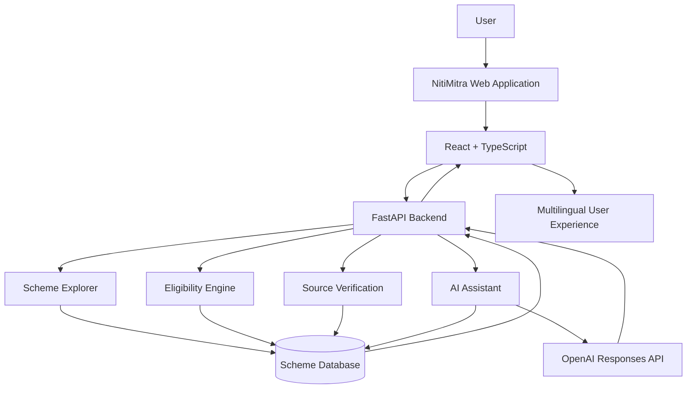

 <div align="center">

# NitiMitra

### Government benefits, explained in your language.

**Making public scheme information easier to discover, understand, and explore.**

<br/>

[](https://react.dev/)
[](https://www.typescriptlang.org/)
[](https://fastapi.tiangolo.com/)
[](https://www.python.org/)
[](https://openai.com/)

<br/>

**English · తెలుగు · हिन्दी**

<br/>

*A multilingual civic information assistant built to make government scheme information more accessible.*

</div>

---

## ◈ The Vision Behind NitiMitra

Public welfare schemes can make a meaningful difference in people's lives. However, finding relevant information, understanding eligibility requirements, and identifying the documents needed to apply can be difficult.

Information is often spread across different websites, presented in complex language, or difficult to understand for people who prefer regional languages.

**NitiMitra brings scheme discovery and preliminary guidance into one accessible digital experience.**

It helps users explore available scheme records, understand eligibility conditions, review document requirements, and interact with an AI-powered multilingual assistant.

> **Our idea is simple:** Public information should be easier to find and easier to understand, regardless of the language a person speaks.

## ◈ Explore NitiMitra

| Feature | What it offers |
|---|---|
| 🔎 Scheme Explorer | Search and explore scheme records. |
| 🗂️ Category Discovery | Browse schemes by their categories. |
| 📋 Scheme Details | Understand benefits, eligibility and application steps when data is available. |
| 🎯 Smart Eligibility Checker | Evaluate structured eligibility conditions. |
| 📑 Document Checklist | Review scheme-specific document requirements when provided. |
| 🤖 AI Assistant | Ask questions through an AI-powered conversational interface. |
| 🌐 Multilingual Experience | Navigate in English, Telugu and Hindi. |
| 🔗 Source Awareness | Distinguish verified information from unverified or demonstration records. |

## ◈ Designed for Everyone

NitiMitra supports three interface languages.

<div align="center">

| English | తెలుగు | हिन्दी |
|:---:|:---:|:---:|
| Explore schemes | పథకాలను అన్వేషించండి | योजनाएँ खोजें |
| Check eligibility | అర్హతను తెలుసుకోండి | पात्रता जाँचें |
| Ask questions | ప్రశ్నలు అడగండి | सवाल पूछें |

</div>

The language selector allows users to change their interface language. Scheme information remains identified according to the language in which its underlying record is available; unofficial translations are not represented as official government translations.

## ◈ How NitiMitra Works

The application connects a user-friendly frontend with a Python backend, structured scheme information, eligibility evaluation, and AI assistance.



## ◈ Technology Behind the Project

<table>
<tr>
<td width="50%" valign="top">

### Frontend

- React
- TypeScript
- Vite
- Tailwind CSS
- React Router
- Lucide React

</td>
<td width="50%" valign="top">

### Backend

- Python
- FastAPI
- Pydantic
- SQLAlchemy

</td>
</tr>
<tr>
<td width="50%" valign="top">

### Database

- SQLite for local development
- SQLAlchemy ORM
- Structured relational records

</td>
<td width="50%" valign="top">

### AI Integration

- Official OpenAI Python SDK
- OpenAI Responses API
- Backend-side AI integration

</td>
</tr>
</table>

## ◈ Project Structure

```text
NitiMitra/
│
├── backend/
│   ├── app/
│   │   ├── main.py
│   │   ├── models/
│   │   ├── routes/
│   │   └── ...
│   ├── .env.example
│   └── ...
│
├── frontend/
│   ├── public/
│   ├── src/
│   │   ├── components/
│   │   ├── pages/
│   │   ├── services/
│   │   ├── data/
│   │   └── lib/
│   └── ...
│
├── docs/
│   └── screenshots/
│
├── .gitignore
├── README.md
└── spec.md
```

*The folder tree is a simplified overview. Refer to the repository for the complete structure.*

## ◈ Run NitiMitra Locally

Want to explore or contribute to NitiMitra? Follow these steps.

### Prerequisites

- Python
- Node.js and npm
- Git
- An OpenAI API key for live AI functionality

### 1. Clone the repository

```bash
git clone https://github.com/kanithikalikowsik/nitimitra-multilingual-scheme-assistant.git

cd nitimitra-multilingual-scheme-assistant
```

### 2. Configure the backend

```powershell
cd backend

python -m venv .venv

.venv\Scripts\activate

pip install -r requirements.txt
```

Configure your local `backend/.env` file using the project's `.env.example` as a reference.

Example:

```env
OPENAI_API_KEY=your_actual_api_key
OPENAI_MODEL=gpt-5.4-mini
OPENAI_TIMEOUT_SECONDS=30
```

Never commit your actual `.env` file or API key.

Start the backend:

```bash
uvicorn app.main:app --reload
```

Backend API documentation:

`http://localhost:8000/docs`

### 3. Start the frontend

Open a second terminal:

```bash
cd frontend

npm install

npm run dev
```

Open the local application:

`http://localhost:5173`

**Note:** Use the dependency installation instructions and environment configuration supplied with the actual project. The backend dependency filename and any required frontend API URL should be checked against the repository before running.

### Backend deployment and database configuration

The backend supports SQLite for local development and PostgreSQL for hosted use. The backend runtime is pinned to Python 3.13 in `backend/.python-version`.

#### Local SQLite

From the repository root, configure the backend environment and start the API:

```powershell
cd backend
Copy-Item .env.example .env
python -m venv .venv
.venv\Scripts\Activate.ps1
python -m pip install -r requirements.txt
uvicorn app.main:app --reload
```

When `DATABASE_URL` is unset, SQLite stores data in `backend/nitimitra.db`. Local startup keeps the existing additive SQLite compatibility migration and restart-safe demo seeding. Existing rows are preserved.

For a new, empty local database, create the schema with Alembic:

```powershell
alembic upgrade head
```

For an existing local SQLite database, start the app once so its legacy compatibility migration can run, inspect and back up the database, then mark the current schema as managed by Alembic:

```powershell
alembic stamp head
```

Do not run the initial `upgrade head` against an existing unversioned database. After adoption, create reviewed migrations with `alembic revision --autogenerate -m "describe schema change"` and apply them with `alembic upgrade head`.

#### PostgreSQL and Render

Set `DATABASE_URL` to the PostgreSQL connection URL supplied by the provider. The backend accepts `postgres://` and `postgresql://` URLs and selects the psycopg 3 driver. Keep credentials in the hosting provider's environment settings, never in source control.

Recommended Render Web Service settings:

- **Root Directory:** `backend`
- **Runtime:** Python 3; `backend/.python-version` pins Python 3.13
- **Build Command:** `python -m pip install -r requirements.txt`
- **Start Command:** `uvicorn app.main:app --host 0.0.0.0 --port $PORT`
- **Health Check Path:** `/health`

Before starting the service against a new PostgreSQL database, run this once from the Render Shell in the `backend` directory:

```bash
alembic upgrade head
```

Apply reviewed Alembic migrations before releases that change the schema. Production startup does not run `create_all` or the SQLite legacy migration. Demo seeding is disabled in production unless `SEED_DEMO_DATA=true` is explicitly set.

Configure these backend environment variables in Render:

| Variable | Production configuration |
|---|---|
| `APP_ENV` | `production` |
| `DATABASE_URL` | Render PostgreSQL connection URL; keep it private |
| `FRONTEND_ORIGINS` | Exact Vercel origin(s), comma-separated, e.g. `https://your-app.vercel.app` |
| `OPENAI_API_KEY` | Optional secret setting for AI features; never put this in Vercel or frontend variables |
| `OPENAI_MODEL` | Optional; defaults to `gpt-5.4-mini` |
| `OPENAI_TIMEOUT_SECONDS` | Optional; defaults to `20` |
| `SEED_DEMO_DATA` | Optional; disabled by default in production |

`FRONTEND_ORIGINS` must list each exact Vercel deployment origin that needs access, with no wildcard. Credentialed CORS is disabled. Local development uses the localhost origins when the setting is absent. `GET /health` checks process availability; `GET /health/ready` returns 503 when the database cannot answer a simple query.

The OpenAI key is read only by the backend. Missing or rejected credentials produce generic assistant responses, and provider logs omit error messages that might contain private request details.

## ◈ API Overview

NitiMitra uses FastAPI to provide backend functionality.

| API area | Purpose |
|---|---|
| Health | Backend availability |
| Categories | Available scheme categories |
| Schemes | Listing, searching and filtering |
| Scheme Details | Retrieve an individual scheme |
| Eligibility | Questionnaire and eligibility evaluation |
| Assistant | AI-powered question and answer interface |

For the exact paths, request methods, and schemas, open the locally running API documentation at `/docs`.

## ◈ Trust, Privacy & Information Reliability

NitiMitra is designed with an important principle: **an answer should not be presented as verified government information without reliable supporting evidence.**

The project includes safeguards intended to:

- Distinguish verified sources from unverified records.
- Avoid treating demonstration information as official information.
- Evaluate eligibility only when supported by structured criteria.
- Avoid inventing official URLs or unsupported requirements.
- Keep OpenAI credentials on the backend.
- Handle unavailable information transparently.

**Current data limitation:** The development database has contained demonstration scheme information and no verified official source records in the latest recorded QA results. The availability of verified scheme-specific guidance therefore depends on adding and validating reliable source records.

## ◈ Project Status

NitiMitra has completed its main implementation and automated quality-assurance phases.

The project has included frontend, backend, multilingual support, eligibility evaluation, and AI integration work.

Actual live AI availability, verified scheme-data coverage, and production deployment must be evaluated separately. Passing automated tests does not by itself establish that every production feature is live.

## ◈ Future Possibilities

NitiMitra can continue evolving through:

- Broader verified government scheme coverage.
- More Indian regional languages.
- Side-by-side scheme comparison.
- Improved accessibility for different user groups.
- More comprehensive document guidance.
- Production analytics and reliability improvements.
- Additional verified government information sources.

## ◈ Why This Project Matters

Technology is most meaningful when it helps people solve real problems.

NitiMitra explores how modern web technologies and multilingual AI assistance can make public information easier to understand and navigate.

The objective is not to replace official government portals, but to help people better understand the information available through reliable sources.

---

<div align="center">

## Built with purpose. Designed for accessibility. Powered by technology.

**NitiMitra**

*Government benefits, explained in your language.*

<br/>

[](https://github.com/kanithikalikowsik/nitimitra-multilingual-scheme-assistant)

<br/>

**An independent civic-tech project. Not affiliated with any government department.**

</div>
