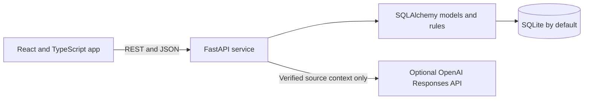

# NitiMitra

**Public scheme information, explained in your language.**

Repository name: `nitimitra-multilingual-scheme-assistant`

NitiMitra is an independent, multilingual civic information project. It provides a searchable interface for scheme records, preliminary eligibility guidance, and a source-aware assistant in English, Telugu, and Hindi.

> NitiMitra is not an official government service. It does not approve or reject applications. Scheme-specific guidance depends on reliable, verified source records being available in the database.

## The problem

Public benefit information can be spread across many government websites and written in language that is difficult to navigate. Language barriers and unclear eligibility conditions make it harder for people to find and understand the information that applies to them.

## The solution

NitiMitra brings scheme records and related guidance into one responsive application. It labels illustrative records as demos, uses verified sources for factual scheme guidance, and communicates when information is missing. Eligibility results are preliminary explanations, never official decisions.

## Features

- English, Telugu, and Hindi interface with language preference saved in the browser.
- Scheme explorer with category filters, search, and detail pages.
- Backend-backed scheme content with source verification status.
- Rule-based eligibility questionnaire and condition-by-condition explanations when verified structured rules exist.
- Document checklist that preserves unknown requirements instead of inventing them.
- Multilingual assistant with server-side OpenAI integration, verified-source filtering, and source references.
- Responsive layouts, loading/error/empty states, and route navigation.
- Questionnaire answers are not stored. Assistant conversation history is temporary in the browser tab and can be cleared.

## Technology

| Layer | Tools |
| --- | --- |
| Frontend | React 18, Vite, TypeScript, React Router, Tailwind CSS, Lucide |
| Backend | Python, FastAPI, Pydantic, SQLAlchemy |
| Database | SQLite by default; another database needs a compatible SQLAlchemy driver and deployment configuration |
| Assistant | OpenAI Responses API called from the backend only |

## Architecture



The API returns scheme records, source status, eligibility results, and assistant responses. Only eligible verified source records are supplied as factual scheme context; model-created URLs are not used as citations. When verified scheme evidence is unavailable, the assistant communicates that limitation rather than treating demo records as confirmed policy.

## Project structure

```text
backend/
  app/              FastAPI routes, models, migrations, seeding, eligibility, assistant
  tests/            Backend tests
  requirements.txt  Python dependencies
frontend/
  src/              Pages, components, translations, API service, styles
  scripts/          Route, translation, and assistant smoke checks
  package.json      Frontend scripts and dependencies
```

## Requirements

- Node.js 20 or newer and npm.
- Python 3.10 or newer.

## Run locally

Run the backend and frontend in separate terminals.

### 1. Backend

From the repository root, in Windows PowerShell:

```powershell
cd .\backend
py -m venv .venv
.\.venv\Scripts\Activate.ps1
python -m pip install -r requirements.txt
Copy-Item .env.example .env
```

Edit `backend/.env` and replace the placeholders with local values. For a typical local run, use `sqlite:///./nitimitra.db` for `DATABASE_URL`, `http://localhost:5173,http://127.0.0.1:5173` for `FRONTEND_ORIGINS`, `gpt-5.4-mini` for `OPENAI_MODEL`, and `20` for `OPENAI_TIMEOUT_SECONDS`. `OPENAI_API_KEY` is optional for general local use; leave it blank when not configured. If you enable the provider, put your key only in this backend file. Do not put it in `frontend/.env` or commit either `.env` file.

Start the API:

```powershell
python -m app.seed
uvicorn app.main:app --reload
```

The API initializes the schema and runs idempotent demo seeding on startup. The seed records are illustrative placeholders, not government schemes. The local database is created under `backend/` by default and is excluded from Git.

### 2. Frontend

In a second terminal, from the repository root:

```powershell
cd .\frontend
npm ci
Copy-Item .env.example .env
npm run dev
```

Set `VITE_API_BASE_URL` in `frontend/.env` to `http://localhost:8000`, then open the local URL printed by Vite, normally <http://localhost:5173>. This frontend setting is public configuration, not a place for secrets.

For macOS/Linux, create the virtual environment with `python3 -m venv .venv`, activate it with `source .venv/bin/activate`, and use `cp .env.example .env` in each project directory.

### Environment variables

| Variable | Location | Purpose |
| --- | --- | --- |
| `DATABASE_URL` | `backend/.env` | SQLAlchemy database URL; defaults to the local SQLite database. |
| `FRONTEND_ORIGINS` | `backend/.env` | Comma-separated browser origins allowed by development CORS. Set the deployed frontend origin before production. |
| `OPENAI_API_KEY` | `backend/.env` only | Optional provider credential. Use your own key locally; never commit it or share it. |
| `OPENAI_MODEL` | `backend/.env` | Optional model name; defaults to the configured application default. |
| `OPENAI_TIMEOUT_SECONDS` | `backend/.env` | Provider request timeout. |
| `VITE_API_BASE_URL` | `frontend/.env` | Backend base URL, normally `http://localhost:8000`. This value is public configuration, not a secret. |

The `.env.example` files contain placeholders only. Replace them in your private `.env` files; do not put real credentials in example files.

## API overview

The API is served locally at `http://localhost:8000`. Interactive documentation is available at `/docs`.

| Method | Endpoint | Purpose |
| --- | --- | --- |
| `GET` | `/health` | Service health check |
| `GET` | `/api/categories` | Categories and scheme counts |
| `GET` | `/api/schemes` | Scheme list; optional `category` filter |
| `GET` | `/api/schemes/search?q=...` | Search; optional `category` filter |
| `GET` | `/api/schemes/{scheme_id}` | Scheme lookup by numeric ID |
| `GET` | `/api/schemes/slug/{slug}` | Scheme lookup by slug |
| `GET` | `/api/schemes/slug/{slug}/eligibility` | Questionnaire generated from available verified rules |
| `POST` | `/api/schemes/slug/{slug}/eligibility-check` | Evaluate submitted answers without storing them |
| `POST` | `/api/assistant/chat` | Multilingual assistant response and database-backed source references |

## Database and scheme data

SQLAlchemy models cover schemes, sources, eligibility rules, documents, and application steps. SQLite is the default for local development. Startup migrations are additive, and seeding is designed to preserve existing records.

The database file is local state and must not be uploaded. The repository does not include an authoritative scheme database. Seeded category entries are explicitly marked illustrative demo placeholders. Scheme-specific guidance should be treated as unavailable until reliable official source information has been reviewed and recorded with verification status and date. Never mark a source verified without checking it.

## Checks

Frontend checks, from `frontend/`:

```powershell
npm run typecheck
npm run i18ncheck
npm run routecheck
npm run assistantcheck
npm run build
```

Backend tests, from `backend/` with the virtual environment active:

```powershell
python -m unittest discover -s tests -v
```

## Screenshots

Screenshots can be added under `docs/screenshots/` before release. No screenshots are included yet.

| Page | Screenshot |
| --- | --- |
| Home | Add screenshot |
| Scheme explorer | Add screenshot |
| Scheme details | Add screenshot |
| Eligibility checker | Add screenshot |
| Assistant | Add screenshot |

## Current limitations

- The bundled seed content is demo-only; verified scheme records are not included.
- Scheme-specific AI guidance requires relevant verified source data and a working provider configuration. Provider availability, credentials, quota, or network access can prevent a model response.
- SQLite is intended for local development. Production database, hosting, monitoring, and CORS configuration require deployment-specific setup.
- This project does not submit applications, connect to government citizen databases, verify identity, or make eligibility decisions.
- No license has been added. Add a license before publishing if you intend to grant reuse rights.

## Future enhancements

- Add carefully reviewed scheme records with official source URLs, verification dates, and sourced translations.
- Add a production database and deployment configuration with restricted CORS origins and secret management.
- Expand automated accessibility and browser coverage.
- Improve source review and update workflows.

## Disclaimer

NitiMitra is an independent informational project and is not affiliated with, endorsed by, or operated by any government department. Its content is general guidance, not legal advice or an official eligibility decision. Scheme details can change. Verify current requirements with the relevant official government source before acting.
